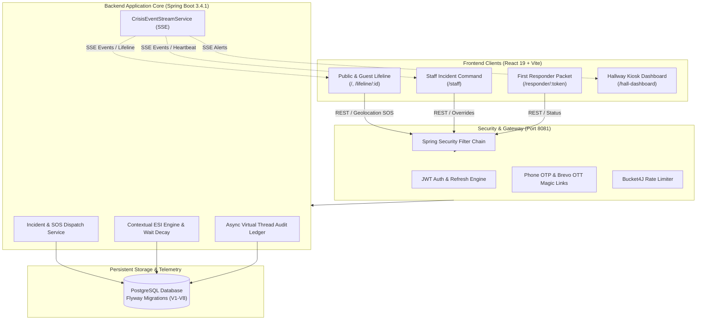

<div align="center">

# 🌉 OmniBridge
### Next-Generation Venue Incident Command, Real-Time Emergency Orchestration & Contextual Clinical Triage Platform

[](https://spring.io/projects/spring-boot)
[](https://openjdk.org/)
[](https://react.dev/)
[](https://vitejs.dev/)
[](https://www.postgresql.org/)
[](LICENSE)

*A unified, mission-critical crisis command system bridging distressed venue guests, first responders, tactical dispatchers, and clinical ER staff through real-time telemetry, immutable audit trails, and algorithmic decision gates.*

---

[Key Highlights](#-key-capabilities) •
[Architecture](#-system-architecture) •
[Quick Start](#-quick-start) •
[Clinical Triage Engine](#-contextual-esi-clinical-triage-engine) •
[Default Credentials](#-default-seed-credentials) •
[API Reference](#-api-specification)

---

</div>

## 📌 Executive Summary

Modern public venues, hospital systems, stadiums, and university campuses experience operational fragmentation during acute emergencies:
1. **Guests** lack real-time visibility and panic when communication lines go cold.
2. **First Responders** lose crucial minutes searching for facility gate codes, floor plans, and Knox Box access.
3. **Emergency Departments & Triage Nurses** face triage bias, inaccurate manual ESI scoring, and stagnant waiting rooms where deteriorating patients are overlooked.

**OmniBridge solves this end-to-end** through a fault-tolerant multi-channel architecture combining **stateless JWT + OTP/OTT MFA**, **Server-Sent Events (SSE)** for zero-polling real-time updates, an **AHRQ 5-Tier Algorithmic ESI Engine** with **Dynamic Wait-Time Decay**, and an **immutable Virtual Thread audit ledger**.

---

## 🚀 Key Capabilities

### 1. 🚨 Incident Command & Guest Lifeline
* **Public SOS Panic Beacon**: One-click emergency distress beacon with browser GPS geolocation (`navigator.geolocation`) that auto-routes the reporter into a dedicated, encrypted lifeline session.
* **Bi-Directional Guest Lifeline (`/lifeline/:incidentId`)**: Real-time visual progress stepper (`REPORTED` ➔ `ACKNOWLEDGED` ➔ `RESPONDING` ➔ `RESOLVED` ➔ `CLOSED`), instant 911/EMS dispatch badges, facility evacuation advisories, and an interactive 2-way dispatch messaging channel.
* **Tactical First Responder Packet (`/responder/:token`)**: Direct-access mobile portal providing field personnel with gate access codes, Knox Box locations, architectural blueprints (PDF), one-click Google Maps GPS navigation, and direct dispatch dialer.
* **Facility Emergency Broadcasts**: Venue-wide security and weather alerts streamed via SSE to active venue displays, notification bells, and guest screens.

### 2. 🏥 Contextual ESI Clinical Triage Engine (AHRQ 5-Tier)
* **Nurse Intake Assessment (`/staff` -> Triage)**: Guided triage entry following Agency for Healthcare Research and Quality (AHRQ) Decision Gates:
  * **Gate A**: Immediate life threats (Airway, Breathing, Hemodynamic collapse, AVPU Unresponsive/Pain) ➔ Auto ESI 1.
  * **Gate B (Subjective Bias Detection)**: Severe pain ($\ge 7/10$), high-risk clinical conditions (ACS, acute stroke signs, diaphoresis), infant fever rules ($>38^\circ\text{C}$ under 3 months), and nurse observations ➔ Auto ESI 2.
  * **Gate C**: Projected hospital resource demand classification ($0 \rightarrow \text{ESI 5}$, $1 \rightarrow \text{ESI 4}$, $\ge 2 \rightarrow \text{ESI 3}$).
  * **Gate D**: Age-stratified Danger Zone Vitals (Pediatric, Infant, Adult tachycardia, hypoxia $<92\%$, extreme blood pressures).
* **Dynamic Wait-Time Decay**:
  Prevents stagnant queue deterioration by continuously boosting patient priority over time:
  $$\text{Priority Score} = \text{Base ESI Weight} + (\text{Elapsed Minutes} \times \text{Decay Rate}) + \text{Objective Vital Risk Bonus}$$
  * *ESI 1*: $+50\text{ pts/min}$ (Base: $10{,}000$)
  * *ESI 2*: $+15\text{ pts/min}$ (Base: $5{,}000$)
  * *ESI 3*: $+5\text{ pts/min}$ (Base: $2{,}000$)
  * *ESI 4*: $+2\text{ pts/min}$ (Base: $1{,}000$)
  * *ESI 5*: $+1\text{ pt/min}$ (Base: $500$)
  * *Vital Bonuses*: Hypoxia ($+200$), Tachycardia/Bradycardia ($+150$), Hypertensive crisis/Hypotension ($+150$), High-risk flag ($+100$).
* **Physician Clinical Review & ESI Override Modal**:
  Dedicated clinical dashboard where doctors review flagged diagnostic discrepancies, view subjective pain and nurse notes, inspect wait decay, and execute clinical overrides logged directly to the immutable audit ledger.
* **Live Queue Transition & Exam Room Calling**:
  * **Call In Exam (`IN_EXAM`)**: Allows attending Doctors and Nurses to call patients into examination rooms, removing them from the active waiting heap and broadcasting the updated queue across venue monitors.
  * **Discharge (`DISCHARGED`)**: Marks patient care complete, removing them from the queue and updating the ledger.
  * **Role-Guarded Actions**: Action buttons are reserved for Doctors (`COORDINATOR`) and Nurses (`STAFF`); System Administrators (`ADMIN`) operate in **View Only** mode to prevent administrative interference with clinical workflows.

### 3. 🛡️ Enterprise Security & Access Control
* **Stateless JWT + Refresh Token Rotation**: Secure HTTP header authorization with client-side interceptors for automated refresh.
* **Passwordless Multi-Factor Authentication (MFA)**:
  * One-Time Token (OTT) 5-minute magic links delivered via Brevo API.
  * 6-digit cryptographic Phone OTP verification with rate limiting (Bucket4J).
* **Role-Based Access Control (RBAC)**: Fine-grained permissions across `ADMIN`, `COORDINATOR`, `STAFF`, `SECURITY`, and `NURSE`.
* **Staff Approval Workflow**: Self-registered personnel remain in `PENDING` review until verified and approved by an authorized administrator.

---

## 🏗️ System Architecture



---

## ⚡ Quick Start

### Prerequisites
* **Java**: JDK 21 or JDK 25 installed and on `PATH`
* **Node.js**: v18.0.0 or higher (`npm` v9+)
* **PostgreSQL**: Running locally on port `5432` with database `omni_bridge`
  ```sql
  CREATE DATABASE omni_bridge;
  ```

---

### 1-Click Launch (Recommended)

#### Option A: Root NPM Command
From the project root:
```bash
npm run dev
# or
npm start
```
*Spawns both backend (`http://localhost:8081`) and frontend (`http://localhost:3000`) concurrently in a single terminal with color-coded logging.*

#### Option B: Windows Automated Scripts
* Double-click **`run-all.bat`** or execute `.\run-all.ps1`.
* Automatically launches backend and frontend in separate windows and opens your browser.
* Double-click **`stop-all.bat`** to terminate all running services.

---

### Manual Launch

#### 1. Backend Service (Spring Boot)
```bash
cd backend
# Windows:
.\mvnw.cmd spring-boot:run

# Linux / macOS:
./mvnw spring-boot:run
```
* Backend starts at `http://localhost:8081`
* Database migrations (V1 to V8) run automatically via Flyway on startup.

#### 2. Frontend Application (React 19 + Vite)
```bash
cd frontend
npm install
npm run dev
```
* Frontend starts at `http://localhost:3000`

---

## 🔑 Default Seed Credentials

All pre-configured testing accounts are provisioned via Flyway migrations with standardized test credentials:

| Role | Name | Email | Password | Access Capabilities |
| :--- | :--- | :--- | :--- | :--- |
| **ADMIN** | System Administrator | `admin@omnibridge.org` | `Admin@1234` | Full Command, User Approvals, Role Promotion, Broadcasts |
| **COORDINATOR** | Doctor 1 (Coordinator) | `doctor1@omnibridge.org` | `Doctor@1234` | Clinical Overrides, Emergency Dispatch, Triage Intake |
| **COORDINATOR** | Doctor 2 (Coordinator) | `doctor2@omnibridge.org` | `Doctor@1234` | Clinical Overrides, Emergency Dispatch, Triage Intake |
| **NURSE** | Nurse 1 (Elena) | `nurse1@omnibridge.org` | `Nurse@1234` | Full AHRQ Nurse Triage Intake, Queue Management |
| **NURSE** | Nurse 2 (Chen) | `nurse2@omnibridge.org` | `Nurse@1234` | Full AHRQ Nurse Triage Intake, Queue Management |
| **SECURITY** | Guard 1 (Marcus) | `guard1@omnibridge.org` | `Guard@1234` | Incident Verification, Security SOS Response |
| **SECURITY** | Guard 2 (Mercer) | `guard2@omnibridge.org` | `Guard@1234` | Incident Verification, Security SOS Response |

> **Note**: For passwordless Magic Link or Phone OTP testing in development, check backend console logs for generated tokens/OTPs when external SMS/SMTP providers are disabled.

---

## 🧬 Contextual ESI Clinical Triage Engine

The OmniBridge Clinical Module implements the **Emergency Severity Index (ESI) Implementation Handbook v5** with mathematical safeguards against subjective bias:

```
[Patient Intake Presentation]
            │
            ▼
┌───────────────────────────────┐
│ Decision Gate A: Life Threat? │ ──── (Yes) ───► [ ESI Level 1: Resuscitation ]
└───────────────────────────────┘                 (Base Score: 10,000 pts)
            │ (No)
            ▼
┌─────────────────────────────────┐
│ Decision Gate B: Subjective Bias│
│ - High-Risk Condition Triggered │
│ - Severe Pain Score (>= 7/10)   │ ──── (Yes) ───► [ ESI Level 2: Emergent ]
│ - Lethargic / Confused / Verbal │                 (Base Score: 5,000 pts)
│ - Infant Fever Rule (< 3 mo)    │
└─────────────────────────────────┘
            │ (No)
            ▼
┌─────────────────────────────────┐
│ Decision Gate C: Resources?     │
│ - 0 Projected Resources         │ ──────────────► [ ESI Level 5: Non-Urgent ] (Base: 500)
│ - 1 Projected Resource          │ ──────────────► [ ESI Level 4: Less Urgent ] (Base: 1,000)
│ - 2+ Projected Resources        │
└─────────────────────────────────┘
            │ (2+ Resources)
            ▼
┌─────────────────────────────────┐
│ Decision Gate D: Danger Vitals? │ ──── (Yes) ───► [ Escalate to ESI Level 2 ]
│ - Hypoxia (SpO2 < 92%)          │
│ - Age-stratified HR / RR limits │
└─────────────────────────────────┘
            │ (Normal Vitals)
            ▼
[ ESI Level 3: Urgent ] (Base Score: 2,000 pts)
```

---

## 🔌 API Specification

### Authentication & Staff Admin (`/api/auth`, `/api/staff-admin`)
- `POST /api/auth/login`: Authenticate with email and password (returns JWT Access + Refresh token).
- `POST /api/auth/refresh`: Exchange refresh token for fresh JWT access token.
- `POST /api/auth/ott/request`: Generate a 5-minute passwordless magic login token.
- `POST /api/auth/ott/consume`: Validate magic link token and authenticate.
- `POST /api/auth/otp/send`: Dispatch 6-digit phone verification code.
- `POST /api/auth/otp/verify`: Verify phone OTP.
- `GET /api/staff-admin/users`: List all staff users with roles and approval statuses (`ADMIN` only).
- `PUT /api/staff-admin/users/{id}/approve`: Approve a pending staff member.
- `PUT /api/staff-admin/users/{id}/role`: Elevate or modify staff roles.

### Incident Command & Dispatch (`/api/report`, `/api/staff/incidents`, `/api/guest`)
- `POST /api/report/{venueSlug}`: Submit guest incident report with optional GPS coordinates.
- `POST /api/report/{venueSlug}/sos`: Submit panic SOS distress beacon.
- `GET /api/staff/incidents/stream`: Real-time SSE stream of facility incidents and status changes.
- `POST /api/staff/incidents/{id}/acknowledge`: Mark incident acknowledged by command.
- `POST /api/staff/incidents/{id}/dispatch-emergency`: Dispatch external 911 / EMS units.
- `POST /api/staff/incidents/{id}/verify`: Verify incident validity and escalate threat tier.
- `GET /api/guest/incidents/{id}?token={token}`: Retrieve guest lifeline telemetry.
- `GET /api/guest/incidents/{id}/stream?token={token}`: SSE stream for guest lifeline.
- `POST /api/guest/incidents/{id}/messages?token={token}`: Distressed guest 2-way dispatch chat.

### Clinical Triage Engine (`/api/v1/triage`)
- `POST /api/v1/triage/intake`: Submit nurse clinical intake assessment, calculate ESI score, and queue.
- `GET /api/v1/triage/queue`: Fetch active priority queue dynamically sorted by decay score.
- `GET /api/v1/triage/public/queue/{venueSlug}`: Unauthenticated endpoint for 3D Public Hall Monitor queue displays.
- `POST /api/v1/triage/review`: Physician clinical review and ESI override with immutable justification logging.
- `PUT /api/v1/triage/status/{intakeId}`: Transition patient status (`IN_EXAM`, `DISCHARGED`, `ADMITTED`) to manage active queue occupancy (Doctors and Nurses).

---

## 📂 Project Directory Structure

```text
omnibridge/
├── backend/                              # Spring Boot Application
│   ├── src/main/java/.../Omni_Bridge/
│   │   ├── config/                       # Security, Async, WebSocket, Rate Limiting
│   │   ├── controller/                   # REST Endpoints (Triage, Incident, Auth, Admin)
│   │   ├── dto/                          # Request & Response Records
│   │   ├── entity/                       # JPA Entities (Incident, StaffUser, PatientIntake)
│   │   ├── repository/                   # Spring Data JPA Repositories
│   │   └── service/                      # Core Business Logic & Triage Engines
│   ├── src/main/resources/
│   │   ├── db/migration/                 # Flyway SQL Migrations (V1 to V8)
│   │   ├── application.properties        # App Configuration
│   │   └── application-dev.properties    # PostgreSQL Connection Settings
│   ├── pom.xml                           # Maven Dependencies
│   └── .env.example                      # Backend Environment Variables Template
│
├── frontend/                             # React 19 + Vite SPA
│   ├── src/
│   │   ├── api/                          # Modular API Clients & Axios Interceptors
│   │   ├── components/                   # Modals, Navbars, SOS Beacons, Triage Forms
│   │   ├── context/                      # AuthContext & Session Management
│   │   ├── pages/                        # Staff Dashboard, Guest Lifeline, Public Report
│   │   ├── App.jsx                       # Routing & Protected Route Guards
│   │   └── index.css                     # Tailwind CSS & Design System
│   ├── package.json                      # Frontend Dependencies & Scripts
│   ├── vite.config.js                    # Vite Configuration & Backend Proxy
│   └── .env.example                      # Frontend Environment Variables Template
│
├── run-all.bat                           # 1-Click Windows Launcher (Command Prompt)
├── run-all.ps1                           # 1-Click Windows Launcher (PowerShell)
├── stop-all.bat                          # 1-Click Process Terminator
├── package.json                          # Root Concurrent Orchestrator
└── README.md                             # Comprehensive Platform Documentation
```

---

## 🧪 Testing & Validation

### Validate Backend Compilation & Unit Tests
```bash
cd backend
.\mvnw.cmd test-compile
```

### Validate Frontend Production Build
```bash
cd frontend
npm run build
```

---

## 📄 License & Attribution

Distributed under the MIT License. Developed for modern emergency preparedness, crisis coordination, and algorithmic healthcare equity.
